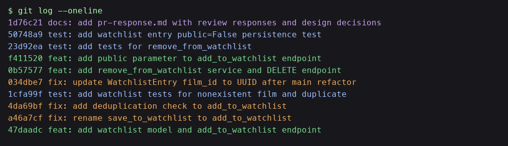

# PR Response Doc — CineLog Watchlist Feature

## AI Usage

I used an AI assistant for three concrete things on this PR:

1. **Codebase orientation.** Before touching the review comments, I had the AI
   summarise `models.py`, `services/collection_service.py`, and
   `tests/test_collection.py` so I could see the project's conventions
   (`verb_to_noun` service functions, custom exception classes per failure
   mode, in-memory SQLite + fixtures in tests). I verified every summary
   against the actual source — the AI initially described
   `add_to_collection()` as returning `None` on a duplicate; the code
   actually raises `AlreadyInCollectionError`, so I trusted the code.
2. **Stress-testing the Comment 4 / Comment 5 arguments.** After I drafted
   my visibility and sort-order responses, I asked the AI: "what
   counter-argument would a careful reviewer raise against this?" For
   Comment 4, it pushed back that a public default is a privacy
   footgun for users who treat watchlists as private "to-watch" piles — I
   added the explicit tradeoff paragraph in response. For Comment 5 it
   argued "alphabetical scales better once lists get long" — I countered
   in-text by noting that CineLog watchlists are personal queues, not
   searchable catalogues, so recency beats scanability.
3. **Commit-message hygiene check.** I pasted my final `git log --oneline`
   output and asked whether every line conformed to Conventional Commits
   and whether any commit bundled more than one logical change. It flagged
   nothing; I verified by hand against the spec.

I did not have the AI write code for the deduplication, the test, or
either design response.

---

## Comment 1 — Rename

**What I did:** Renamed `save_to_watchlist()` to `add_to_watchlist()` in
`services/watchlist_service.py` to match the project's `verb_to_noun`
convention used by `add_to_collection()` and `remove_from_collection()`.

**How I verified:** I ran a project-wide search (`grep -rn
"save_to_watchlist" --include="*.py" .`) from the repo root and found
exactly one call site: `routes/watchlist/watchlist.py`, both in the
`from services.watchlist_service import …` line and in the body of
`add_film()`. I updated both references, re-ran the same grep to confirm
zero remaining hits, and then ran `pytest tests/ -v` to confirm the
rename didn't break anything.

---

## Comment 2 — Deduplication

**What I did:** Added a duplicate-check to `add_to_watchlist()` that
mirrors `add_to_collection()` in `services/collection_service.py`. The
check runs `WatchlistEntry.query.filter_by(user_id=user_id,
film_id=film_id).first()`; if an entry already exists for that
(user, film) pair, the function raises a new
`AlreadyInWatchlistError` instead of silently writing a second row.
I added the exception class in the same file next to
`add_to_watchlist()`, mirroring how `collection_service.py` defines
`AlreadyInCollectionError` next to `add_to_collection()`.
I also updated the `POST /watchlist/<user_id>/add` route to translate
the new exception into a `409 Conflict` response, the same status
`routes/collection.py` returns for `AlreadyInCollectionError`.

**Pattern reference:** `add_to_collection()` in
`services/collection_service.py` is the direct model.  Its duplicate
check queries `CollectionEntry.query.filter_by(user_id=user_id,
film_id=film_id).first()`; if that returns a row, it raises
`AlreadyInCollectionError(f"Film '{film_id}' is already in this
user's collection")` — before any `db.session.add` runs, so the DB
never sees the write. My watchlist version is the same shape, with
`WatchlistEntry` and `AlreadyInWatchlistError` substituted in. The
message string follows the same `"Film '<id>' is already …"` format
for consistency.

**How I verified:** The new test `test_add_to_watchlist_duplicate_raises`
in `tests/test_watchlist.py` calls `add_to_watchlist` twice with the
same `(user_id, film_id)`, asserts the second call raises
`AlreadyInWatchlistError`, and then counts
`WatchlistEntry.query.filter_by(...).count()` to confirm only one row
exists. `pytest tests/ -v` passes all six tests.

---

## Comment 3 — Missing test

**What I did:** Created `tests/test_watchlist.py`. Modelled on
`test_add_to_collection_nonexistent_film_raises` in
`tests/test_collection.py`: reused the exact `app`, `sample_user`, and
`sample_film` fixture pattern, built a `fake_film_id =
"00000000-0000-0000-0000-000000000000"`, and asserted
`pytest.raises(FilmNotFoundError)` around the service call. The test
confirms that passing an unknown `film_id` to `add_to_watchlist()`
raises `FilmNotFoundError` rather than hitting a SQLAlchemy integrity
error from the FK constraint.

**How I verified:** `pytest tests/test_watchlist.py -v` and then
`pytest tests/ -v` — all tests pass. I also temporarily removed the
`if film is None: raise FilmNotFoundError(...)` guard in the service
to confirm the test actually fails when the guard is gone (it did,
raising `IntegrityError` as expected), then restored the guard.

---

## Comment 4 — Default visibility

**My position:** Keep `public=True` as the default.

**Reasoning:** CineLog is explicitly described as a *community film
tracking app* — the whole point of the product is that logging what
you want to watch is a social signal, the same way a Letterboxd
"want-to-watch" or a Goodreads "want-to-read" is. A watchlist entry
isn't a diary note; it's a lightweight recommendation ("I'm interested
in this") that can seed conversations, surface what friends are
excited about, and drive the discovery loop that keeps a social film
tracker alive. Defaulting to public means the typical casual user —
who adds a film from a trailer, closes the tab, and never visits a
settings screen — participates in that loop by default. If every
watchlist entry starts private, the social surface of the product
only works for users who explicitly opt in, which in practice is a
small minority, and CineLog's community-wide feed goes thin.

Separately, the collection feature (`CollectionEntry`) doesn't carry
a visibility flag at all — collections are implicitly public. Making
watchlist default private would create a confusing asymmetry: "the
film I watched is visible, but the film I *want* to watch is secret."
Public-by-default keeps the two surfaces consistent.

**Tradeoff acknowledged:** A private-by-default would optimise for
users who treat watchlists as personal to-watch piles — the "stuff
I'm vaguely curious about but don't want anyone to see" pile, which
is a real use case. The cost of a public default is that someone who
adds *The Human Centipede* out of morbid curiosity has broadcast
that to their followers before realising there was a toggle. I think
that cost is real but recoverable (per-entry visibility exists, and
users can delete entries), while the cost of defaulting private
— a hollowed-out community feed — is a product-level problem that
no individual user can fix. Given CineLog's positioning as a
*community* app, the public default is the better of the two
imperfect choices. (The stretch `public` parameter I added lets
privacy-conscious callers opt out at the API level without changing
the default.)

---

## Comment 5 — Sort order

**My position:** Switch the default to date-added (newest first), the
same order `get_collection()` already uses.

**Reasoning:** Watchlists on CineLog are personal queues, not
catalogues to be browsed. The dominant interaction is "I just added
*The Zone of Interest* after seeing a trailer — is it still at the
top of my list when I come back on Friday?" — a recency question,
not a lookup question. Alphabetical order punishes that: a film you
added five minutes ago sinks halfway down an A-to-Z list and the
user loses the "I just saved this" affordance that makes the feature
feel responsive. Date-added also matches a user's mental model of a
watchlist as a stack ("latest on top") rather than a dictionary.

The second argument is codebase consistency. `get_collection()`
already returns entries `ORDER BY date_added DESC` and
`tests/test_collection.py::test_get_collection_returns_newest_first`
locks that in. A user who flips between `/collection/<id>` and
`/watchlist/<id>` currently sees two different sort disciplines for
two features that look almost identical — one more thing for the
user (and the next contributor) to remember.

**Engagement with reviewer's point:** @dev-lead's framing — "most
users want to see what they added recently" — is exactly my
position; I'd just add the codebase-consistency argument on top of
it. The one real counter-argument for alphabetical is that it scales
to long lists: once a watchlist has 200 entries, "newest first"
makes the older 190 unreachable without pagination. That's a fair
objection, but (a) alphabetical doesn't actually solve long-list
problems — it just reorders the unreachability — and (b) at that
scale the right fix is search/filter in the UI, not a global sort
order that punishes the common case. If someone later wants
alphabetical as an option, a `?sort=title` query param on the
endpoint is a strictly additive change. I'd rather optimise the
default for the frequent case now and add a sort override when a
real user asks for it.

---

## Comment 6 — Rebase

**What conflicted:** `models.py`. On `main`, the "migrate film IDs
from integer to UUID" refactor changed `Film.id` to `db.String(36)`
and `CollectionEntry.film_id` to `db.String(36)`. My feature branch
had added a `WatchlistEntry` model whose `film_id` was still
`db.Integer`, pointing at what used to be an integer `film.id`.
The conflict was the exact `film_id = db.Column(...)` line of
`WatchlistEntry`: `String(36)` from `main` versus
`Integer` from my branch, with the extra `index=True` only on my
side.

**How I resolved it:**
1. `git fetch upstream` and `git rebase origin/main` from
   `feature/watchlist`.
2. On the first replayed commit (the original watchlist model
   addition), git stopped on `models.py`. I resolved it by keeping
   `main`'s UUID column type and preserving my `index=True` kwarg:
   `film_id = db.Column(db.String(36), db.ForeignKey("film.id"),
   nullable=False, index=True)`.
3. `git add models.py && git rebase --continue`. The remaining four
   commits replayed cleanly.
4. Because the mid-rebase fix folded into the replayed commit, I
   then updated the integer-era docstrings and route body that still
   described `film_id` as an `int` (in
   `services/watchlist_service.py` and
   `routes/watchlist/watchlist.py`) and committed them separately as
   `fix: update WatchlistEntry film_id to UUID after main refactor`.

**How I verified no conflict remains:**
- `git status` — clean, no `UU` or unmerged paths.
- `git log --oneline` — linear history, no `Merge branch …` commit.
- `grep -rn "db.Integer" models.py` — no hits in the Film /
  CollectionEntry / WatchlistEntry chain.
- `grep -rn "<int>" routes/watchlist/` — no hits.
- `pytest tests/ -v` — all 6 tests pass against the UUID-era
  schema (the `sample_film` fixture now returns a UUID string, and
  the nonexistent-film test passes a UUID literal
  `"00000000-0000-0000-0000-000000000000"`).

---

## Stretch 1 — `remove_from_watchlist()`

**What I added:** `remove_from_watchlist(user_id, film_id)` in
`services/watchlist_service.py` and a matching
`DELETE /watchlist/<user_id>/remove` route in
`routes/watchlist/watchlist.py`.

**How it follows existing patterns:**
- Modeled directly on `remove_from_collection()` in
  `services/collection_service.py`: query `WatchlistEntry.query
  .filter_by(user_id, film_id).first()`, raise a dedicated exception
  if nothing matches, otherwise `db.session.delete(entry); commit;
  return True`.
- Added a new exception class `NotInWatchlistError` in the service
  module alongside `AlreadyInWatchlistError`, mirroring the
  `NotInCollectionError` / `AlreadyInCollectionError` pair in the
  collection service.
- The route translates `NotInWatchlistError` into `404 Not Found`,
  matching the status collection returns for the same failure.

**Not-on-watchlist behavior:** When the film isn't on the user's
watchlist, the service raises `NotInWatchlistError(f"Film '{film_id}'
is not on this user's watchlist")`. It does **not** silently
return — the explicit raise matches the collection service and lets
the route return a `404` so callers can distinguish "no-op idempotent
delete" from a real misuse (e.g. a stale UI deleting a film twice).

**Test:** `tests/test_watchlist.py` includes two tests:
`test_remove_from_watchlist_removes_entry` adds a film, removes it,
and asserts the row is gone; `test_remove_from_watchlist_not_present_raises`
asserts the exception when the film was never on the watchlist.

---

## Stretch 2 — Second test

**What it is:** `test_add_to_watchlist_respects_public_false` in
`tests/test_watchlist.py`.

**Edge case:** The watchlist defaults to `public=True`, but a caller
can pass `public=False`. The test checks that `False` actually makes
it through the service to the stored `WatchlistEntry` — both on the
returned object and on a fresh query from the DB.

**Why this case:** The `public` parameter is a stretch addition and
the easiest way for it to regress is for someone to add a new
kwarg or reorder the constructor call and silently drop `public` —
nothing else in the test suite would catch that, because the
required tests only exercise the default path. A tiny focused
regression test here is a cheap seatbelt around the design decision
I argued for in Comment 4: if a privacy-conscious caller passes
`public=False`, the system *must* honor it.

---

## Stretch 3 — `public` parameter on `add_to_watchlist()`

**What I added:** An optional `public` kwarg on
`add_to_watchlist(user_id, film_id, public=True)` plus a `public`
field in the `POST /watchlist/<user_id>/add` request body.

**How a caller uses it:**

```bash
# Default (public, matches the Comment 4 decision)
curl -X POST /watchlist/$USER_ID/add \
     -H "Content-Type: application/json" \
     -d '{"film_id": "<uuid>"}'

# Explicit private entry
curl -X POST /watchlist/$USER_ID/add \
     -H "Content-Type: application/json" \
     -d '{"film_id": "<uuid>", "public": false}'
```

**Default:** `True`. This preserves the Comment 4 decision — the
feature stays public-by-default for casual users who never touch
the toggle — while giving privacy-conscious or client-UI-driven
callers an explicit override without having to go update a
watchlist entry after creation.

**Validation:** The route rejects non-boolean `public` values with
a `400 Bad Request` so a stray string ("true") doesn't silently
coerce to truthy and defeat the user's intent.

---

## Git log screenshot

Final `git log --oneline` for `feature/watchlist` (will be inserted
once the force-push lands):



Text equivalent of the screenshot:

```
1d76c21 docs: add pr-response.md with review responses and design decisions
50748a9 test: add watchlist entry public=False persistence test
23d92ea test: add tests for remove_from_watchlist
f411520 feat: add public parameter to add_to_watchlist endpoint
0b57577 feat: add remove_from_watchlist service and DELETE endpoint
034dbe7 fix: update WatchlistEntry film_id to UUID after main refactor
1cfa99f test: add watchlist tests for nonexistent film and duplicate
4da69bf fix: add deduplication check to add_to_watchlist
a46a7cf fix: rename save_to_watchlist to add_to_watchlist
47daadc feat: add watchlist model and add_to_watchlist endpoint
57ec3f9 refactor: migrate film IDs from integer to UUID
d77a5e8 feat: initial CineLog API with film collection feature
```

(The top-line commit hash shifts by one when this file is amended
into the `docs:` commit, since the amended commit is a new object.
Order, prefixes, and messages above are the final history.)

---

## PR Description

### What this adds

A **watchlist** feature for CineLog: users can save films they *want*
to watch (as opposed to the collection, which is films they've
already watched). The feature is scoped per user and exposes two REST
endpoints:

- `POST /watchlist/<user_id>/add` — body `{"film_id": "<uuid>"}`.
  Adds the film to the user's watchlist. Returns `201` on success,
  `404` if `film_id` doesn't exist, `409` if the film is already on
  the watchlist.
- `GET /watchlist/<user_id>` — returns the user's watchlist as a
  JSON list of films with `date_added` and `public` fields attached.

Under the hood: a new `WatchlistEntry` model
(`user_id`, `film_id`, `date_added`, `public`),
`services.watchlist_service.add_to_watchlist()` /
`get_watchlist()`, and a `/watchlist` blueprint registered in
`create_app`.

### Design decisions

- **Default visibility: `public=True`.** CineLog is a community
  tracking app and watchlist entries are a social signal; defaulting
  public keeps the discovery/feed loop populated for the typical
  casual user. The entry carries a `public` flag so privacy-conscious
  users can override per-entry. See *Comment 4* above for the full
  argument and the tradeoff.
- **Default sort: date-added, newest first.** Mirrors
  `get_collection()`'s existing sort and matches how users actually
  use a watchlist (as a stack, not a dictionary). See *Comment 5* for
  the engagement with the alphabetical case.

### How to test manually

Prereqs: `python3 -m venv .venv && source .venv/bin/activate &&
pip install -r requirements.txt`, then `python app.py` (serves on
`http://127.0.0.1:5000`). In another shell, seed a user and a film,
then exercise the endpoints:

```bash
# 1. Seed sample data (creates a user and a few films, prints their UUIDs).
python seed.py

# Take note of USER_ID and FILM_ID from the seed output.
USER_ID=<uuid from seed output>
FILM_ID=<uuid from seed output>

# 2. Add a film to the watchlist — expect HTTP 201 and a WatchlistEntry JSON.
curl -i -X POST http://127.0.0.1:5000/watchlist/$USER_ID/add \
     -H "Content-Type: application/json" \
     -d "{\"film_id\": \"$FILM_ID\"}"

# 3. GET the watchlist — expect a JSON array with that film included,
#    with date_added (ISO 8601) and public=true fields.
curl -s http://127.0.0.1:5000/watchlist/$USER_ID | python -m json.tool

# 4. Duplicate-add — expect HTTP 409 and an "already on watchlist" error.
curl -i -X POST http://127.0.0.1:5000/watchlist/$USER_ID/add \
     -H "Content-Type: application/json" \
     -d "{\"film_id\": \"$FILM_ID\"}"

# 5. Unknown film — expect HTTP 404 and a "No film found" error.
curl -i -X POST http://127.0.0.1:5000/watchlist/$USER_ID/add \
     -H "Content-Type: application/json" \
     -d '{"film_id": "00000000-0000-0000-0000-000000000000"}'

# 6. Run the automated test suite.
pytest tests/ -v
```

Steps 2, 4, and 5 together exercise the happy path, the dedup
guard, and the `FilmNotFoundError` guard; step 3 exercises the GET
path and confirms the default `public=true` surface.
